# Projeto - Cidades ESGInteligentes

**TerraPulse API**: API RESTful em ASP.NET Core 8 para monitoramento ambiental de cidades inteligentes, com indicadores ESG, alertas ambientais e recomendações sustentáveis. Este repositório traz o ciclo DevOps completo da aplicação: containerização, orquestração e pipeline CI/CD com deploy automatizado em **staging** e **produção** no Azure.

| | |
|---|---|
| **Aluno** | Herbert Dias de Souza (RM 565128) |
| **Curso / Fase** | 2TDS - Fase 6: Navegando pelo mundo DevOps |
| **Repositório** | `https://github.com/herbds12/terrapulse-devops` |
| **Staging** | `https://terrapulse-stg-rm565128.azurewebsites.net/swagger` |
| **Produção** | `https://terrapulse-prd-rm565128.azurewebsites.net/swagger` |

## Estrutura do projeto

```text
terrapulse-devops/
├── .github/workflows/ci-cd.yml   # Pipeline CI/CD (GitHub Actions)
├── Dockerfile                    # Imagem multi-stage da API
├── docker-compose.yml            # Orquestração local: API + SQL Server
├── .env.example                  # Modelo de variáveis de ambiente
├── TerraPulse.sln
├── src/TerraPulse.Api/           # Código-fonte da API (.NET 8)
├── tests/TerraPulse.Tests/       # Testes automatizados (xUnit)
├── infra/azure-setup.sh          # Script que cria staging e produção no Azure
├── infra/azure-cleanup.sh        # Remove os recursos do Azure
└── docs/                         # Documentação, evidências (prints) e PDF
```

## Como executar localmente com Docker

**Pré-requisitos:** Docker Desktop (ou Docker Engine + Compose v2).

```bash
# 1. Clonar o repositório
git clone https://github.com/herbds12/terrapulse-devops.git
cd terrapulse-devops

# 2. Criar o arquivo de variáveis de ambiente
cp .env.example .env          # no PowerShell: copy .env.example .env

# 3. Subir API + banco (build da imagem incluso)
docker compose up -d --build

# 4. Acompanhar os logs até aparecer "Now listening on: http://[::]:8080"
docker compose logs -f terrapulse-api
```

| Recurso | URL |
|---|---|
| Swagger | http://localhost:8080/swagger |
| Health check | http://localhost:8080/health |
| SQL Server (cliente externo) | `localhost,14333`, usuário `sa`, senha do `.env` |

As migrations do Entity Framework são aplicadas automaticamente na subida. Elas também criam o usuário administrador de teste:

```json
{ "email": "admin@terrapulse.ai", "senha": "Terra@123" }
```

Comandos úteis:

```bash
docker compose ps                 # status dos containers (o banco deve ficar "healthy")
docker compose down               # para os containers (mantém os dados no volume)
docker compose down -v            # para e apaga o volume do banco
```

Para rodar os testes fora do pipeline, suba só o banco com `docker compose up -d terrapulse-sqlserver` e execute:

```bash
ConnectionStrings__DefaultConnection="Server=localhost,14333;Database=TerraPulseDb_Tests;User Id=sa;Password=TerraPulse@2026#Db;TrustServerCertificate=True;Encrypt=False" \
Database__ApplyMigrations=true dotnet test
```

## Pipeline CI/CD

**Ferramentas:** GitHub Actions (orquestração do pipeline), GitHub Container Registry `ghcr.io` (registro das imagens Docker), Azure App Service for Containers (hospedagem) e Azure SQL Database (banco gerenciado de cada ambiente).

**Arquivo:** [`.github/workflows/ci-cd.yml`](.github/workflows/ci-cd.yml)

### Fluxo de branches (GitFlow simplificado)

| Evento | Etapas executadas | Ambiente |
|---|---|---|
| Pull request para `develop`/`main` | Build → Testes | (nenhum; bloqueia o merge se falhar) |
| Push em `develop` | Build → Testes → Imagem Docker → Deploy | **Staging** |
| Push/merge em `main` (ou disparo manual `workflow_dispatch`) | Build → Testes → Imagem Docker → **Aprovação manual** → Deploy | **Produção** |

```text
 ┌───────┐   ┌────────┐   ┌──────────────┐   ┌──────────────────┐
 │ Build │──▶│ Testes │──▶│ Docker image │──▶│ Deploy Staging   │  (develop)
 └───────┘   └────────┘   │  → ghcr.io   │   └──────────────────┘
                          └──────────────┘──▶│ Deploy Produção  │  (main + aprovação)
                                             └──────────────────┘
```

### Etapas

1. **Build:** `actions/setup-dotnet` instala o .NET 8; em seguida `dotnet restore` e `dotnet build -c Release` compilam a solução inteira (API + testes).
2. **Testes automatizados:** o GitHub Actions sobe um **SQL Server 2022 como service container**. Os testes de integração xUnit (`WebApplicationFactory`) iniciam a API real, que aplica as migrations nesse banco e chama os endpoints de autenticação, áreas monitoradas, indicadores, alertas, recomendações e `/health`. O resultado em `.trx` fica salvo como artefato e um resumo aparece na página da execução.
3. **Build & push da imagem:** `docker/build-push-action` gera a imagem a partir do `Dockerfile` (com cache do GitHub Actions) e a publica no `ghcr.io` com duas tags: o **SHA do commit** (imutável, rastreável) e o canal (`staging` ou `production`).
4. **Deploy:** `azure/webapps-deploy` atualiza o Web App do ambiente com a imagem do commit. A autenticação usa o *publish profile*, guardado como secret.
5. **Smoke test pós-deploy:** o pipeline consulta `/health` até a API responder `Healthy` **com o SHA do commit que acabou de ser publicado**. Assim se comprova que a versão nova está no ar e conectada ao banco; se isso não acontecer, o job falha.

### Ambientes e segredos

| Ambiente GitHub | Web App Azure | Banco Azure SQL | Proteção |
|---|---|---|---|
| `staging` | `terrapulse-stg-rm565128` | `terrapulse-staging` (Basic) | Deploy automático |
| `production` | `terrapulse-prd-rm565128` | `terrapulse-production` (Basic) | **Required reviewer** (aprovação manual) |

- **Secrets:** `AZURE_PUBLISH_PROFILE_STAGING`, `AZURE_PUBLISH_PROFILE_PRODUCTION`
- **Variables:** `AZURE_WEBAPP_STAGING`, `AZURE_WEBAPP_PRODUCTION`
- Connection strings, chave JWT e demais configurações ficam nas **App Settings** de cada Web App, nunca no código.

Região: **Chile Central** (permitida pela assinatura Azure for Students). A infraestrutura dos dois ambientes é criada de forma reproduzível pelo script [`infra/azure-setup.sh`](infra/azure-setup.sh), que usa a Azure CLI.

## Containerização

### Dockerfile

```dockerfile
# =====================================================================
# TerraPulse API - Dockerfile multi-stage (.NET 8)
# Contexto de build: raiz do repositorio
# =====================================================================

# ---------- Etapa 1: build e publish ----------
FROM mcr.microsoft.com/dotnet/sdk:8.0 AS build
WORKDIR /source

# Copia apenas o .csproj primeiro para aproveitar o cache do "restore"
COPY src/TerraPulse.Api/TerraPulse.Api.csproj src/TerraPulse.Api/
RUN dotnet restore src/TerraPulse.Api/TerraPulse.Api.csproj

# Copia o restante do codigo e publica em modo Release
COPY src/ src/
RUN dotnet publish src/TerraPulse.Api/TerraPulse.Api.csproj \
    -c Release \
    -o /app/publish \
    --no-restore \
    /p:UseAppHost=false

# ---------- Etapa 2: runtime ----------
FROM mcr.microsoft.com/dotnet/aspnet:8.0 AS final
WORKDIR /app

# Versao da imagem (SHA do commit), informada pelo pipeline
ARG APP_VERSION=local
ENV APP_VERSION=${APP_VERSION} \
    ASPNETCORE_URLS=http://+:8080 \
    ASPNETCORE_ENVIRONMENT=Production \
    DOTNET_RUNNING_IN_CONTAINER=true

LABEL org.opencontainers.image.title="terrapulse-api" \
      org.opencontainers.image.description="TerraPulse - API ESG para Cidades Inteligentes" \
      org.opencontainers.image.version="${APP_VERSION}"

COPY --from=build /app/publish .

# Executa com usuario nao-root (ja existente na imagem oficial do .NET 8)
USER $APP_UID

EXPOSE 8080

ENTRYPOINT ["dotnet", "TerraPulse.Api.dll"]
```

### Estratégias adotadas

- **Multi-stage build:** o SDK (~800 MB) só existe na etapa de build; a imagem final usa apenas o runtime `aspnet:8.0`, o que a deixa bem menor e com menos superfície de ataque.
- **Cache de camadas:** o `.csproj` é copiado e restaurado antes do código, então o `dotnet restore` só roda de novo quando as dependências mudam.
- **Usuário não-root:** `USER $APP_UID` (usuário `app` da imagem oficial).
- **Configuração 12-factor:** nada sensível na imagem. Connection string, JWT, ambiente, migrations e Swagger chegam por **variáveis de ambiente**, e a mesma imagem roda em local, staging e produção.
- **Rastreabilidade:** o argumento `APP_VERSION` recebe o SHA do commit e fica visível em `/health` e no label OCI da imagem.
- **`.dockerignore`:** exclui `bin/`, `obj/`, testes, docs e `.env` do contexto de build.

### docker-compose.yml (orquestração)

| Elemento | Uso |
|---|---|
| **Serviços** | `terrapulse-api` (build do Dockerfile) e `terrapulse-sqlserver` (SQL Server 2022) |
| **Rede** | `terrapulse-network` (bridge): a API acessa o banco pelo nome do serviço |
| **Volume** | `terrapulse-sqlserver-data` → `/var/opt/mssql`, persiste os dados entre reinícios |
| **Variáveis** | lidas do `.env` (senha do banco, chave JWT, portas, ambiente) |
| **Healthcheck** | `sqlcmd SELECT 1` no banco; a API só sobe depois que o banco está `healthy` (`depends_on: condition: service_healthy`) |
| **Restart** | `unless-stopped` nos dois serviços |

### Adaptações na aplicação para produção

- Migrations automáticas controladas por variável (`Database__ApplyMigrations`), e não só pelo ambiente Docker.
- `EnableRetryOnFailure` no EF Core, para tolerar falhas transitórias e o *auto-pause* do Azure SQL serverless.
- Endpoint `/health` com ambiente, versão e status do banco, usado pelo smoke test.
- Swagger habilitável por variável (`Swagger__Enabled`) em staging e produção.
- Testes de integração rodando contra SQL Server real no CI, sem paralelismo entre classes (evita corrida nas migrations).

## Prints do funcionamento

> As imagens ficam em [`docs/prints/`](docs/prints/). A documentação técnica em PPT/PDF traz todas comentadas.

### Execução local com Docker
| Evidência | Print |
|---|---|
| Build da imagem e subida do Compose (rede, volume, banco *healthy*) | 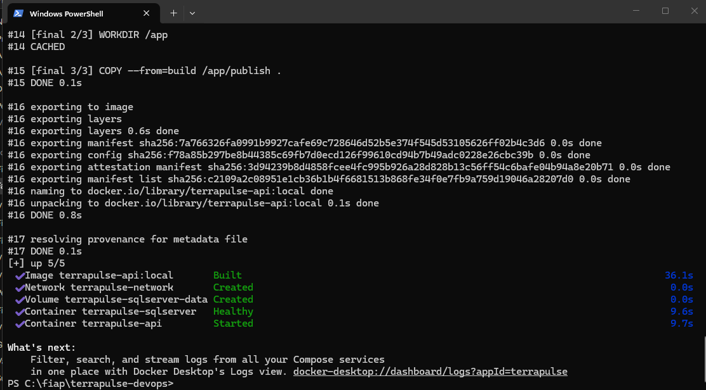 |
| `docker compose ps`: API e SQL Server rodando | 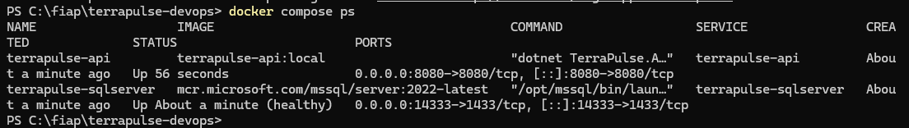 |
| `/health` local conectado ao banco | 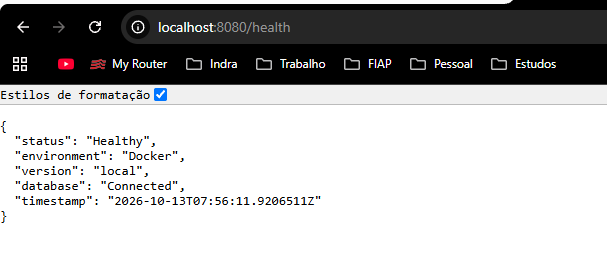 |
| Swagger local: GET autenticado retornando 200 | 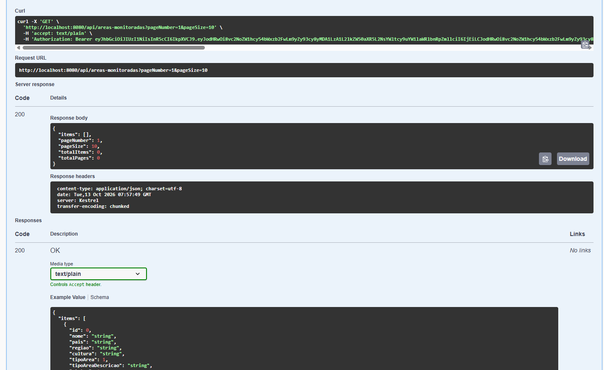 |

### Pipeline CI/CD
| Evidência | Print |
|---|---|
| Pipeline da branch `develop`: Build → Testes → Docker → Deploy Staging | 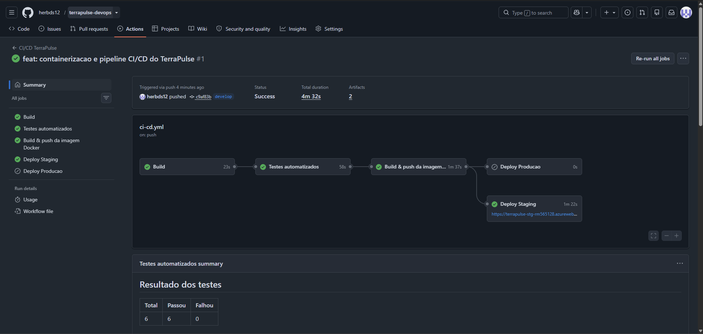 |
| Testes automatizados: 6 de 6 aprovados | 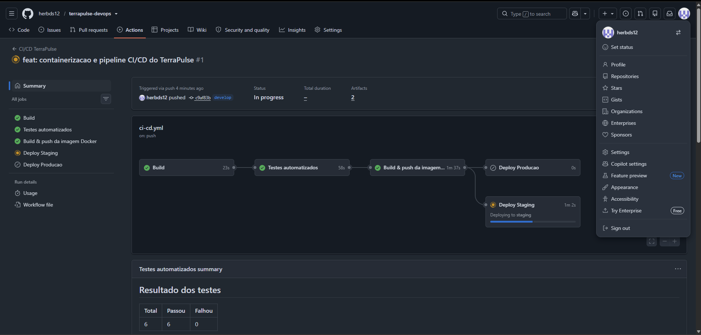 |
| Imagem publicada no GHCR com a tag do SHA do commit | 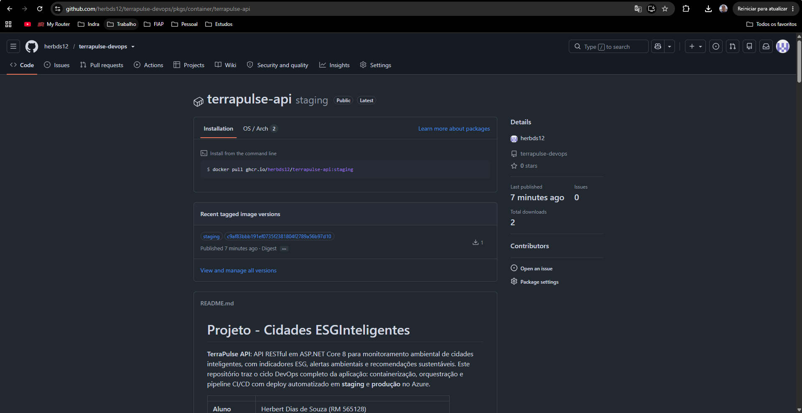 |
| Aprovação manual exigida para produção | 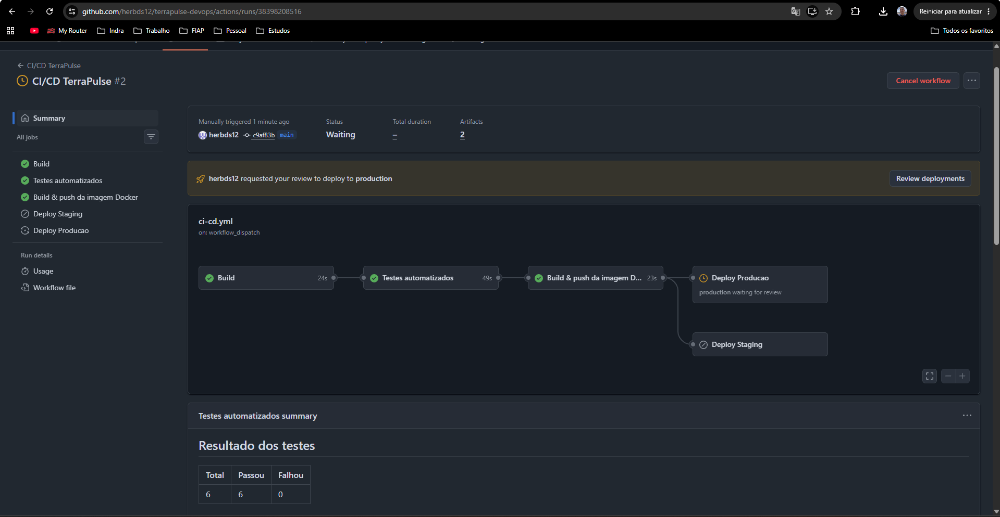 |
| Pipeline da branch `main` com Deploy Produção aprovado | 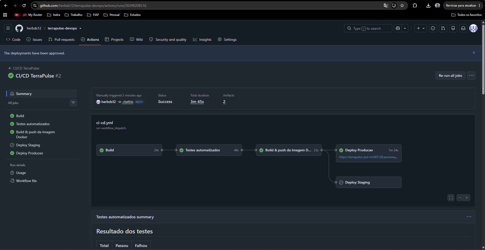 |

### Staging
| Evidência | Print |
|---|---|
| `/health`: `Staging`, versão `c9af83b…`, banco conectado | 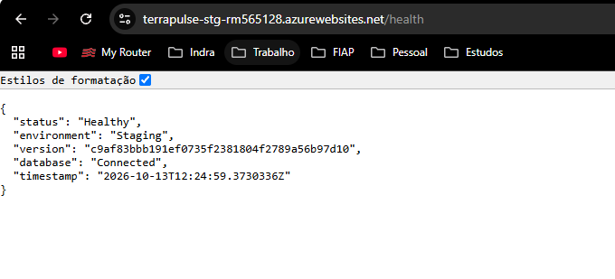 |
| Swagger: login respondendo 200 | 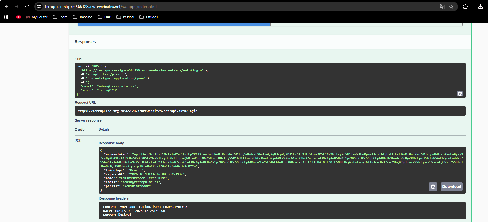 |

### Produção
| Evidência | Print |
|---|---|
| `/health`: `Production`, versão `c9af83b…`, banco conectado | 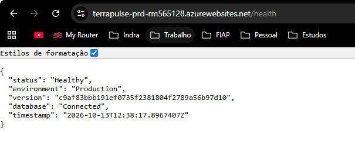 |
| Swagger: login respondendo 200 | 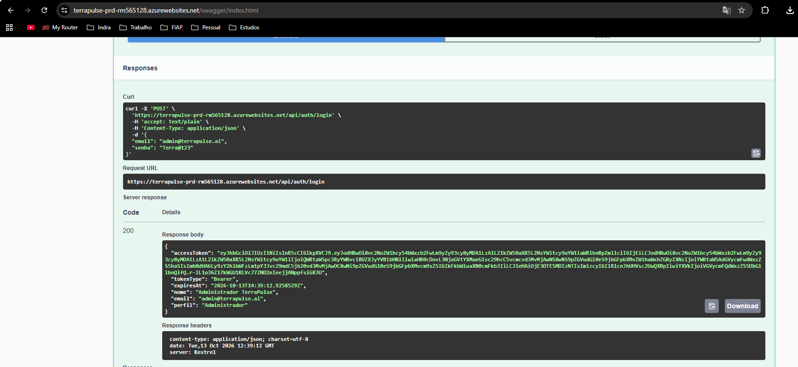 |

### Infraestrutura e configuração
| Evidência | Print |
|---|---|
| Resource Group no Azure (plano, 2 Web Apps, SQL Server, 2 bancos) | 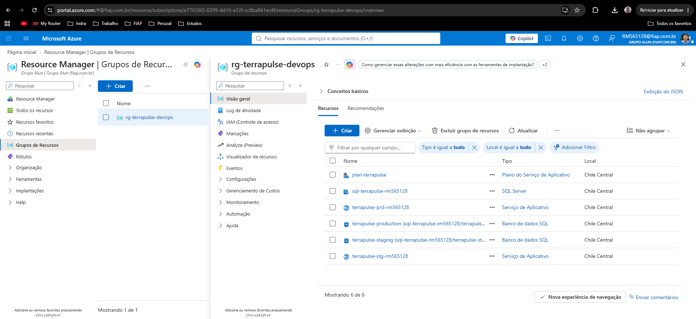 |
| GitHub Environments (`production` com aprovação obrigatória) | 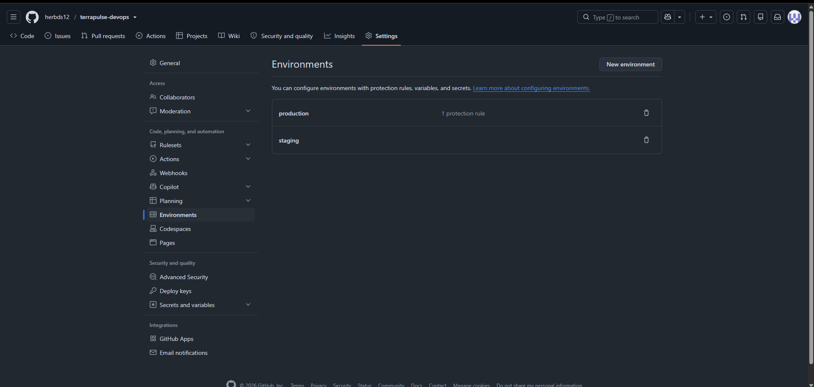 |
| Secrets do pipeline | 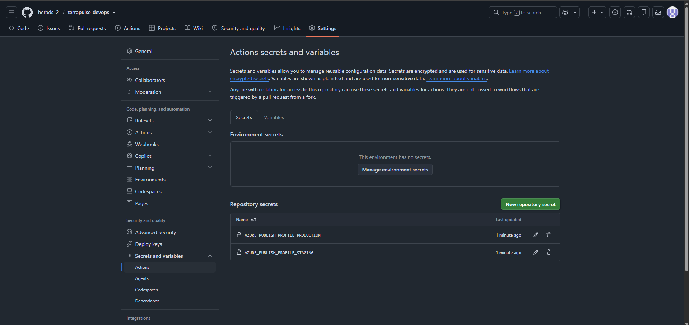 |
| Variables do pipeline | 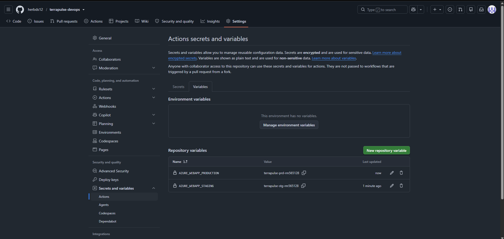 |

**Links:**
- Execuções do pipeline: https://github.com/herbds12/terrapulse-devops/actions
- Staging: https://terrapulse-stg-rm565128.azurewebsites.net/swagger
- Produção: https://terrapulse-prd-rm565128.azurewebsites.net/swagger

## Desafios encontrados e soluções

| Desafio | Solução |
|---|---|
| Os testes existentes eram de integração (`WebApplicationFactory`) e dependiam de um SQL Server LocalDB, que não existe no runner Linux do GitHub Actions. | SQL Server 2022 como *service container* no job de testes; migrations aplicadas por variável (`Database__ApplyMigrations`) e paralelismo do xUnit desligado para evitar corrida nas migrations. |
| A assinatura Azure for Students bloqueou a criação em `eastus2` (`RequestDisallowedByAzure`). | Consulta da policy com `az policy assignment list` e uso de uma das regiões permitidas: **Chile Central**. |
| A oferta gratuita do Azure SQL não é suportada nessa região (`ProvisioningDisabled`). | O script `azure-setup.sh` passou a cair automaticamente para o tier **Basic** e a ser idempotente: pode ser rodado de novo sem duplicar recursos. |
| Criar a branch `main` apontando para o mesmo commit da `develop` não disparou o workflow, porque o filtro `paths-ignore` não encontra arquivos alterados. | Disparo manual com `workflow_dispatch` na branch `main`; o deploy de produção seguiu com aprovação manual. |
| O Azure precisa conseguir baixar a imagem do registry. | Repositório público, então o pacote no GHCR ficou público e o Web App baixa a imagem sem credenciais extras. |
| Garantir que o deploy realmente subiu a versão nova. | Endpoint `/health` exibindo o SHA do commit e smoke test no pipeline, que só passa quando o ambiente responde `Healthy` com o SHA esperado. |

## Tecnologias utilizadas

| Camada | Tecnologias |
|---|---|
| Aplicação | C# / .NET 8, ASP.NET Core Web API, Entity Framework Core 8, AutoMapper, JWT Bearer, Swagger (Swashbuckle) |
| Banco de dados | SQL Server 2022 (local/CI) e Azure SQL Database (staging/produção) |
| Testes | xUnit, `Microsoft.AspNetCore.Mvc.Testing` (testes de integração) |
| Containers | Docker (multi-stage), Docker Compose |
| CI/CD | GitHub Actions, GitHub Environments (aprovação manual), GitHub Container Registry |
| Nuvem | Microsoft Azure: App Service (Linux, Web App for Containers), Azure SQL, Azure CLI / Cloud Shell |
| Versionamento | Git + GitHub (branches `develop` e `main`) |

Detalhes funcionais da API (endpoints, autenticação e exemplos) estão em [`docs/API.md`](docs/API.md).

## Checklist de entrega

| Item | OK |
|---|---|
| Projeto compactado em .ZIP com estrutura organizada | ☑ |
| Dockerfile funcional | ☑ |
| docker-compose.yml ou arquivos Kubernetes | ☑ |
| Pipeline com etapas de build, teste e deploy | ☑ |
| README.md com instruções e prints | ☑ |
| Documentação técnica com evidências (PDF ou PPT) | ☑ |
| Deploy realizado nos ambientes staging e produção | ☑ |
